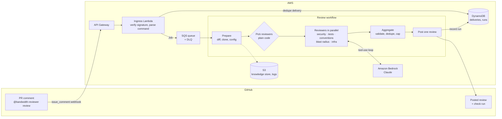

# Bandwidth AI Code Reviewer

A GitHub App, hosted on AWS, that posts a focused code review on a pull request when someone comments `@bandwidth-reviewer review`. Specialist reviewers (security, test gaps, conventions, blast radius, infra) run in parallel, and the bot posts one combined `COMMENT` review. It never approves or blocks merges.

See [spec.md](spec.md) for the full design, [implementation-plan.md](implementation-plan.md) for milestones, and [agent-setup.md](agent-setup.md) for how the reviewer agents work.

## Architecture

1. **Ingress** verifies the webhook, ignores anything that isn't a command, claims the delivery ID in DynamoDB to drop duplicates, queues a `Job` on SQS and returns `200` in about a second.
2. **Worker** checks the commenter's permission, reacts 👀, opens an in-progress check, and runs the workflow.
3. **Prepare** fetches the diff, clones the head SHA and loads config and conventions into one `ReviewContext`.
4. **Reviewers** are chosen by plain code, then each runs a read-only agent loop on Bedrock and returns `Finding`s.
5. **Aggregate** keeps findings that land on diff lines, removes duplicates and applies thresholds and caps.
6. **Post** writes a single GitHub review, completes the check, and records the run.

Phase 0 runs steps 3–6 in-process in one worker Lambda. Phase 1 moves them into Step Functions, with one container Lambda per reviewer.

## What's in this repo today

| Path | Part of the diagram |
| --- | --- |
| [src/reviewer/core/commands.py](src/reviewer/core/commands.py) | Ingress: parses `@bandwidth-reviewer <command>` from the comment |
| [src/reviewer/core/models.py](src/reviewer/core/models.py) | `Job` (SQS message), `ReviewContext` (Prepare output), `Finding` (reviewer output) |
| [src/reviewer/storage.py](src/reviewer/storage.py) | DynamoDB `DeliveryStore`: delivery claim/lease for dedupe, installation events |
| [tests/test_commands.py](tests/test_commands.py) | Command parser tests |

The Lambdas, workspace, agent runtime, reviewers, aggregator and CDK infra are planned but not built yet.
